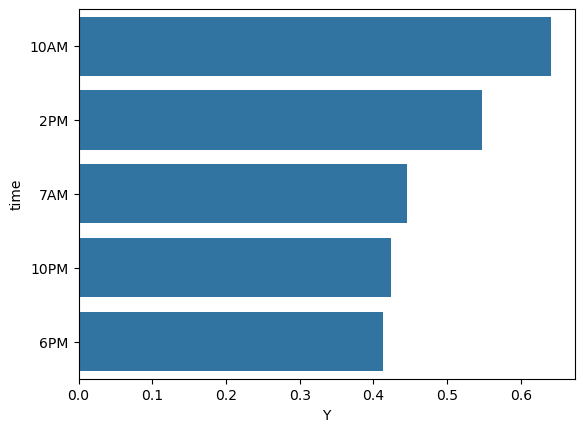
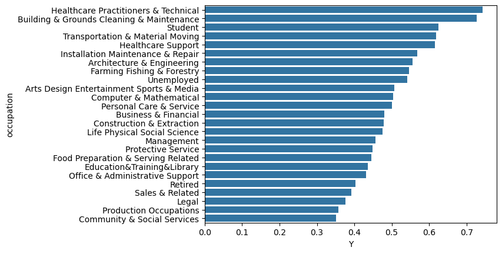
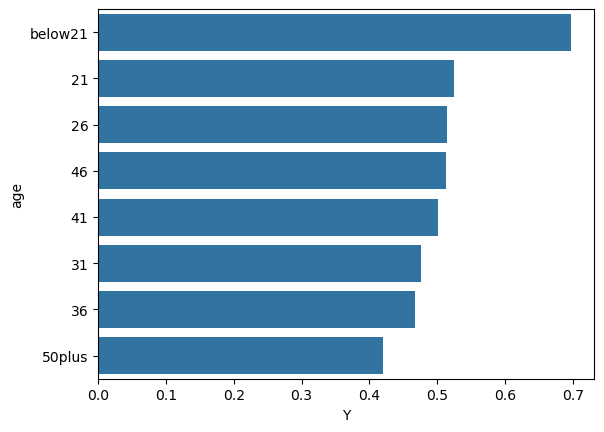
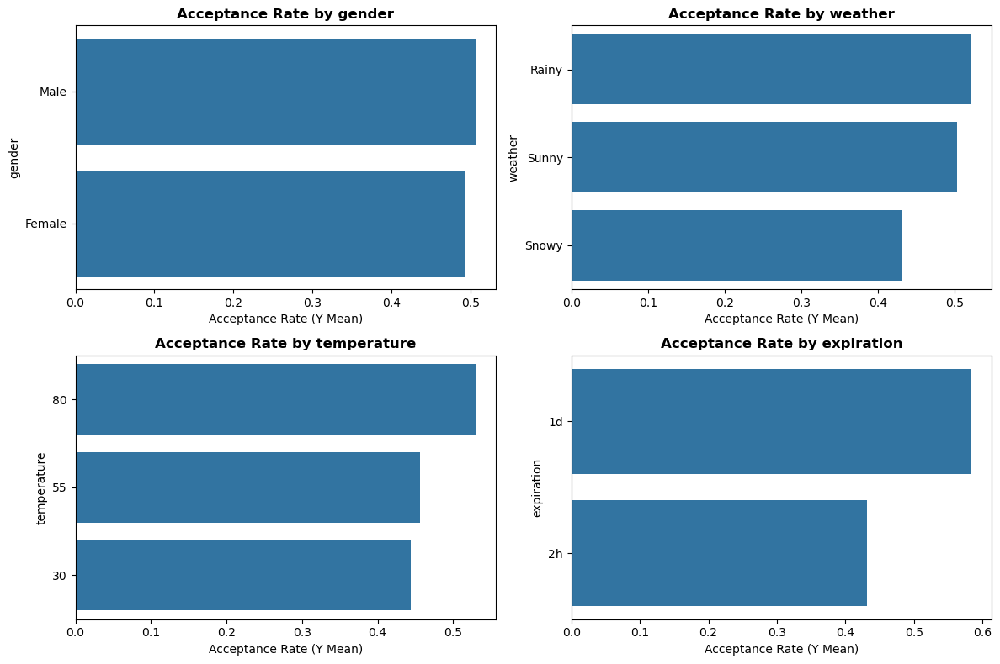

# Will the Customer Accept the Coupon?

## Overview

This project explores which drivers are most likely to accept a mobile coupon. The data comes from the UCI Machine Learning Repository and contains **12,684 driving scenarios**, you can look at the dataset here: [coupons.csv](data/coupons.csv). Each row describes a driver, trip context, and five coupon types. Then we have the target variable, `Y`, which is `1` when the driver accepts the coupon (right away or later before coupon expires), or '1' when the driver does not want the coupon.

The full analysis is in the Jupyter notebook: [`prompt.ipynb`](prompt.ipynb)

### Problem

**Coffee House coupons are the largest coupon segment in the data, but only about half are accepted (49.9%).** The question for this analysis is:

**Which driver demographics are a good indicator for wanting to accept a coupon for a coffee house**

### Visualizations

**Coffee House acceptance by time of day.** Mid-morning and early afternoon are better than early morning and evening.

**Coffee House acceptance by occupation.** Students, healthcare workers, and blue collar jobs accepted at higher rates.

**Coffee House acceptance by age.** Younger drivers accept at higher rates.

**Coffee House acceptance across other context variables.** Expiration, weather, and temperature show differences; gender differences are negligible.

### Interpretation

Seeing all of the data and visualizing with the seaborn library's barplot, we can create decent assumptions of demographic behaviors of people who are more likely to accept a coupon for coffee houses. One surprising event in the data is that rainy and sunny days have nearly identical acceptance rate responses. This could be that while I associate coffee houses with hot drinks, within the last few decades, including more cold drinks such as cold coffee, tea, and "refreshers" must be bringing customers in for cold drinks as well. This conclusion is further supported by the relationship the temperature and the data, when the temperatures are the hotter, people are actually more likely to accept coupons for coffe houses. 

Some additional notes were that gender doesn't have play a strong influence, which was surprising to me. Acceptance rate was another group I looked at, which the outcome made sense, it concludes that longer expiration time leads to a higher acceptance rate. This could be because people are more likely to use the coupon if it fits better in their schedule, 2 hours is fairly soon and people may not have the time for it. Lastly, occupation and age had great influence on accptance rate, with younger recipients, nurses, students, and blue collar jobs with a high acceptance rate. Office jobs noteably aren't high and I think this is related to why older people might not have as high of an acceptance rate. My hypothesis is that people who are older are more likely to have more stationary admin roles and are likely to have access to drinks in their office or maybe just are not interested in going out for drinks as other groups.

### Actionable items

**1. Schedule coffee offers around 10AM–2PM.** Late-morning and early afternoon strongly outperform the other times. Shift coffee promotions this window for higher acceptance rates.

**2. Use one-day expiration for Coffee House coupons.** One-day offers are accepted at **15% more**  for two-hour offers, giving more flexibility 

**3. Target younger drivers and selected occupations when demographic targeting is available.** Students, healthcare, and blue collar drivers that are younger show higher acceptance, but do not rely on gender as that wasn't a useful demographic.

### Next steps and recommendations

1. **Investigate more columns for more insight** We only looked at a few different features that showed demographic differences in acceptance rate. Looking at other could provide important unseen data.

2. **Run a focus group** Because we discovered that older people tend not to accept these coupons, ask them directly what some reasons why they might not accept the coupon and how to better reach these groups.

3. **Use more advanced models** Machine learning and AI can be used as a tool to run deeper data analysis that is not within the scope of this project. Doing so could provide deeper insights and relationships in the data.